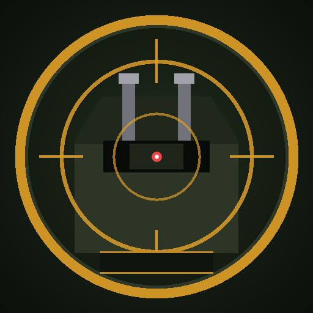

# 🎖️ Pacific Defence

<p align="center">
  
</p>

<h3 align="center">3D First-Person Coastal Bunker Defense Arcade Game</h3>

<p align="center">
  <strong>Hold the Coastal Fortress. Suppress the Landing Craft. Repel the Beachhead Invasion.</strong>
</p>

<p align="center">
  <a href="https://beach-defence-1944.vercel.app"></a>
  <a href="https://o1egkl.github.io/beach-defence-1944/"></a>
  
  
  
</p>

---

## 📖 Table of Contents

1. [Game Overview](#-game-overview)
2. [Core Rules & Victory / Defeat Conditions](#-core-rules--victory--defeat-conditions)
3. [The 4-Weapon Tactical Arsenal](#-the-4-weapon-tactical-arsenal)
4. [Command Bunker & Weapon Upgrade Armory](#-command-bunker--weapon-upgrade-armory)
5. [Enemy Invasion Dossier](#-enemy-invasion-dossier)
6. [20-Wave Campaign Progression](#-20-wave-campaign-progression)
7. [Tactical Exit & Military Discharge Protocol](#-tactical-exit--military-discharge-protocol)
8. [Comprehensive Controls & Hotkeys](#-comprehensive-controls--hotkeys)
9. [Scoring, Accuracy & Combat Multipliers](#-scoring-accuracy--combat-multipliers)
10. [Platforms & How to Run](#-platforms--how-to-run)
11. [Architecture & Technical Stack](#-architecture--technical-stack)

---

## 🎮 Game Overview

**Pacific Defence** places you behind the reinforced embrasure of a frontline coastal concrete bunker during a massive coastal amphibious landing operation. 

Armed with a heavy machine gun, high-explosive anti-tank coastal cannons, anti-armor rocket launchers, and fragmentation grenades, your objective is to eliminate incoming waves of amphibious landing craft, storming infantry squads, mechanized armor, and naval bombardment fleets before they breach your fortifications.

The game features:
- **Procedural 3D Ocean Simulation**: Realistic multi-speed swells, shore shoaling, breaking surf, and dynamic water foam.
- **Detailed 3D Viewmodels**: Authentic Heavy Rapid MG with animated bolt recoil, spent brass casings ejection physics, barrel heat glow, and heavy muzzle flashes.
- **Anatomical Enemy Soldiers**: Procedural uniform meshes with running gait animations, strafing, combat fire, and realistic crumple physics upon elimination.
- **Capital Naval Fleet**: Offshore battleships and destroyers firing periodic long-range naval bombardment salvos with rising smoke plumes.
- **Synthetic Battlefield Audio**: Real-time procedural audio synthesis using the Web Audio API for gunshots, cannon blasts, shrapnel explosions, shell casings tinkling, ocean ambience, and mechanical reload clanks.

---

## ⚖️ Core Rules & Victory / Defeat Conditions

### 🏰 Bunker Integrity & Structural Health
- The bunker starts with **100% Structural Health** at the beginning of each wave.
- Incoming enemy troops and armored vehicles that successfully cross the beach and reach your bunker perimeter inflict immediate structural breach damage:

| Enemy Unit Type | Breach Damage to Bunker | Threat Level |
| :--- | :---: | :--- |
| **Rifleman Infantry** (`rifle`) | **10%** | Standard infantry grunt |
| **Assault Stormtrooper** (`storm`) | **15%** | Helmeted, fast-sprinting assault soldier |
| **Armored Scout Car** (`scout_car`) | **20%** | Fast-moving motorized reconnaissance vehicle |
| **M3 Armored Halftrack** (`halftrack`) | **25%** | Heavy troop transport with mounted machine gun |
| **M4 Amphibious Tank** (`tank`) | **35%** | Heavy armor shelling the bunker with high-explosive rounds |
| **Colossus Dreadnought Tank** (`boss_tank`) | **50%** | Massive invasion boss tank with immense firepower |

### 💥 Defeat Condition
- **BUNKER OVERRUN**: If the bunker sustains **100% cumulative damage** (Bunker Health drops to 0%), the position is compromised, triggering the **Defeat / Wave Overrun Screen**.
- Players can immediately **Retry Wave**, return to the **Armory** to re-spec upgrades, or **Exit Game**.

### 🏆 Victory Condition
- **BEACHHEAD SECURED**: When all scheduled landing craft and storming troops for the current wave are destroyed or resolved, and the bunker integrity remains **> 0%**, the wave is cleared.
- Surviving players are awarded **War Requisition Score** based on combat kills, headshots, landing craft sinkings, remaining time, and shot accuracy.

---

## 🔫 The 4-Weapon Tactical Arsenal

Switch weapons on the fly using number keys `[1]`, `[2]`, `[3]`, or the mouse wheel to match incoming armor profiles.

### 1. 💥 Heavy Rapid MG Heavy Machine Gun (`Slot 1`)
- **Role**: Primary sustained suppression against massed infantry and fast-moving foot soldiers.
- **Fire Rate**: 520 - 1,600 rounds per minute (RPM).
- **Ammo Capacity**: 45 - 120+ rounds per belt drum.
- **Critical Multiplier**: 2.6× - 4.5× damage on headshots and weak points.
- **Mechanics**: High-cyclic firing builds up **Barrel Heat**, causing the steel shroud to glow fiery red. Depleting the drum triggers an automatic cooling cycle with an authentic metal clank reload.

### 2. 🛡️ 75mm Anti-Tank Coastal Cannon (`Slot 2`)
- **Role**: Heavy armor-piercing ordnance against landing craft, armored half-tracks, and tanks.
- **Base Damage**: 540+ (scales with weapon upgrades and wave tech multipliers).
- **Armor Penetration**: 90% AP, ignoring heavy steel armor plating.
- **Ammo Capacity**: 24 - 50+ heavy cannon shells.
- **Blast Radius**: High splash damage capable of destroying entire clusters of landing craft cargo before deployment.

### 3. 🚀 Heavy Anti-Tank Rocket Launcher (`Slot 3`)
- **Role**: High-velocity explosive projectile launcher designed for long-range vehicle and boat interdiction.
- **Base Damage**: 480+ (heavy kinetic and concussive blast).
- **Armor Penetration**: 75% AP.
- **Ammo Capacity**: 10 - 25+ heavy rockets.
- **Splash Damage**: Concussive radius that flips light vehicles and clears sandbar footholds.

### 4. 💣 Tactical Ordnance & Support Abilities

- **Fragmentation Grenades (`[G]` Key / HUD Button)**:
  - Thrown with authentic parabolic physics arcs down onto the sand dunes.
  - Explodes after 1.8 seconds with lethal shrapnel radius, obliterating clusters of troops.
- **Time Booster / Bullet Time (`[T]` Key / HUD Button)**:
  - Injects adrenaline, slowing down battlefield simulation speed for critical seconds.
  - Allows the commander to line up precision headshots, lead fast landing craft, or recover from overwhelming breach rushes.
- **Parachute Supply Drops**:
  - Transport planes periodically drop resupply crates via parachutes across the beachhead containing bonus repair kits, grenades, and time boosters.

---

## 🛠️ Command Bunker & Weapon Upgrade Armory

Between invasion waves, commanders access the **Command Bunker & Weapon Upgrade Armory** to spend requisition score on 4 progressive upgrade trees:

```
┌────────────────────────────────────────────────────────────────────────┐
│                   PRE-LEVEL COMMAND BUNKER ARMORY                      │
├─────────────────────┬────────────────────┬─────────────────────────────┤
│ Upgrade Path        │ Starting Base Cost │ Primary Tactical Effect     │
├─────────────────────┼────────────────────┼─────────────────────────────┤
│ 💥 AP Caliber &     │ 200 Requisition    │ Increases bullet damage &   │
│    Rifling          │ (x1.28 per tier)   │ Armor Penetration %         │
├─────────────────────┼────────────────────┼─────────────────────────────┤
│ ⛓️ Extended Ammo    │ 170 Requisition    │ Increases drum magazine     │
│    Belt             │ (x1.26 per tier)   │ capacity before cooldown    │
├─────────────────────┼────────────────────┼─────────────────────────────┤
│ ❄️ Water-Cooled     │ 180 Requisition    │ Decreases mandatory barrel  │
│    Jacket           │ (x1.26 per tier)   │ cooling duration            │
├─────────────────────┼────────────────────┼─────────────────────────────┤
│ ⚡ Cyclic Booster   │ 180 Requisition    │ Boosts firing RPM and       │
│    & Optics         │ (x1.26 per tier)   │ headshot crit multiplier    │
└─────────────────────┴────────────────────┴─────────────────────────────┘
```

> **Wave Tech Multiplier**: As you advance through higher waves, the effectiveness of all purchased upgrades automatically scales higher (`+(1 + waveIndex * 0.16)`), keeping your arsenal potent against late-game armored divisions!

---

## 🪖 Enemy Invasion Dossier

```
  🚢 HIGGINS BOAT (LCVP)         🪖 INFANTRY TROOPS             🚜 ARMORED FLEET
┌────────────────────────┐    ┌────────────────────────┐    ┌────────────────────────┐
│ Speed: 21.5+ m/s       │    │ Rifleman: 58-120 HP    │    │ Scout Car: Fast Recon  │
│ Origin: Horizon Fleet  │    │ Stormtrooper: 102+ HP  │    │ Halftrack: Mounted Gun │
│ Armor: Steel Bow Ramp  │    │ Headshot: Instant Kill │    │ M4 Tank: 540-1200 HP   │
│ Cargo: 3 - 6 Units     │    │ Damage: 10% - 15%      │    │ Dreadnought Boss Tank  │
└────────────────────────┘    └────────────────────────┘    └────────────────────────┘
```

1. **Landing Craft (LCVP Higgins Boats & LCMs)**:
   - Speed in towards the beach at 21.5+ m/s with visible churning white foam wakes.
   - Upon hitting the shallows, drop steel bow ramps to disembark troops.
   - *Tactical Tip*: Destroying boats with cannons or rockets *before* they drop ramp eliminates all onboard troops simultaneously!
2. **Invasion Riflemen**:
   - Standard frontline troops armed with service rifles. Move in staggered lines up the beach dunes.
3. **Assault Stormtroopers**:
   - Tougher veterans equipped with steel combat helmets. Possess 12% inherent armor reduction and higher sprint speeds.
4. **Armored Scout Cars & Halftracks**:
   - Fast mechanized vehicles carrying squad reinforcements and providing suppressing fire.
5. **Amphibious Tanks & Colossus Dreadnoughts**:
   - Heavily armored combat vehicles capable of absorbing sustained machine gun fire. Must be neutralized using high-caliber AT cannons and rockets.

---

## 🌊 20-Wave Campaign Progression

The campaign features 20 hand-crafted, progressively intensifying waves:

- **Waves 1 – 4 (Beachhead Recon)**: Small motorboat scouts, dispersed Higgins boats, and rifleman probing attacks. Ideal for testing weapon ranges and securing early headshot requisition.
- **Waves 5 – 8 (Amphibious Shock Assault)**: Introduction of armored stormtroopers and rapid-flanking double Higgins boat waves.
- **Waves 9 – 12 (Mechanized Armor Infiltration)**: M3 halftracks and scout cars storm ashore under naval bombardment support.
- **Waves 13 – 16 (Full-Scale Beachfront Incursion)**: Heavy M4 amphibious tanks land under cover of offshore battleship salvos.
- **Waves 17 – 20 (The Final Colossus Offensive)**: Massive combined-arms operations featuring dreadnought boss tanks, non-stop landing craft lines, and relentless stormtrooper charges.

---

## 🚪 Tactical Exit & Military Discharge Protocol

*Pacific Defence* includes a dedicated, authentic **Military Discharge Protocol** system allowing players to exit cleanly at any time:

1. **Multiple In-Game Access Points**:
   - **Armory Screen Header**: Tactical `🚪 EXIT GAME` button located at the top-right.
   - **Armory Screen Footer Bar**: Dedicated `🚪 Exit Game` button next to *Reset Campaign*.
   - **In-Game Pause Menu (`#pause-modal`)**: Full-width `🚪 EXIT GAME TO DESKTOP` button.
   - **Wave Overrun / Defeat Screen (`#defeat-modal`)**: Tactical `🚪 EXIT` button.
2. **Tactical Confirmation Modal (`#exit-modal`)**:
   - Prompts the commander: *"ABANDON BUNKER? Are you sure you want to quit the mission and exit to your desktop?"*
   - Offers **`◀ CANCEL & STAY`** or **`🚪 EXIT GAME`**.
   - Clicking outside the modal frame (on the dark backdrop) safely dismisses it.
3. **Cross-Platform Exit Handlers**:
   - **Windows Desktop App**: Communicates via Electron IPC (`window.electronAPI.quitApp()`), shutting down the application cleanly.
   - **Web Browser**: Attempts `window.close()` with an in-game discharge advisory alert.

---

## 🕹️ Comprehensive Controls & Hotkeys

| Action | Primary Control | Secondary Hotkey | Notes |
| :--- | :--- | :--- | :--- |
| **Aim Turret / Camera** | **Mouse Move** | Touch Drag (Mobile) | Direct 3D crosshair aiming with recoil compensation |
| **Fire Active Weapon** | **Left Mouse Click** | `[Space]` Key / Hold | Continuous automatic fire for Heavy Rapid MG; semi-auto for cannons |
| **Select Heavy Rapid MG Machine Gun** | **`[1]` Key** | Mouse Wheel Up / Down | High cyclic fire, anti-infantry |
| **Select 75mm AT Cannon** | **`[2]` Key** | Number Pad `[2]` | Heavy armor piercing, anti-tank |
| **Select Heavy Rocket** | **`[3]` Key** | Number Pad `[3]` | High-explosive burst ordnance |
| **Manual Reload / Vent** | **`[R]` Key** | HUD Reload Button | Clears drum or chamber before entering forced cooldown |
| **Throw Fragmentation Grenade**| **`[G]` Key** | HUD Grenade Button | Arced physics throw into troop clusters |
| **Activate Time Booster** | **`[T]` Key** | HUD Booster Button | Bullet-time slow motion for precision aiming |
| **Pause / Resume Game** | **`[Esc]` Key** | `[P]` Key / HUD ⏸ Button| Opens Tactical Pause Menu during active waves |
| **Quick Exit (Armory Screen)** | **`[Esc]` Key** | Armory Exit Buttons | Opens Military Discharge Protocol from main bunker menu |
| **Toggle Fullscreen Mode** | **`[F11]` Key** | Window Maximize | Borderless fullscreen arcade mode |
| **Immediate Desktop Quit** | **`[Ctrl + Q]`** | — | Windows standalone desktop application exit |
| **Deploy / Start Wave** | **`[Enter]` Key** | `[Space]` / `[E]` Key | Starts the scheduled invasion wave from the Armory |

---

## 🎯 Scoring, Accuracy & Combat Multipliers

War Requisition Points are awarded for battlefield performance:

- **Infantry Elimination**: `+100` Requisition Points
- **Stormtrooper Elimination**: `+150` Requisition Points
- **Halftrack / Scout Car Destroyed**: `+250` Requisition Points
- **Amphibious Tank Destroyed**: `+500` Requisition Points
- **Landing Craft Sunk (at sea)**: `+400` Bonus Requisition Points
- **Headshot / One-Shot Kill**: `+75` Critical Bonus Points
- **Accuracy Rating**: Calculated at wave completion (`(Shots Hit / Shots Fired) * 100`). High accuracy grants substantial bonus score!
- **Time Bonus**: Remaining wave time is converted into combat requisition points upon securing the beachhead.

---

## 🚀 Platforms & How to Run

### 1. 🌐 Instant Web Play (Zero Installation)
Simply open the game in any modern browser with WebGL support (Chrome, Edge, Firefox, Safari, Opera):
- **Vercel Production**: [https://beach-defence-1944.vercel.app](https://beach-defence-1944.vercel.app)
- **GitHub Pages**: [https://o1egkl.github.io/beach-defence-1944/](https://o1egkl.github.io/beach-defence-1944/)

### 2. 💻 Native Windows Desktop Application
The game can be built and run as a standalone Windows x64 executable:

```bash
# 1. Clone the repository
git clone https://github.com/o1egkl/beach-defence-1944.git
cd beach-defence-1944

# 2. Install dependencies
npm install

# 3. Launch in development mode
npm start

# 4. Build standalone Windows executables
npm run dist
```

Built distributables are generated inside the `dist/` directory:
- **`dist/Pacific Defence 1.0.0.exe`**: 100% portable standalone executable (no installation required).
- **`dist/Pacific Defence Setup 1.0.0.exe`**: Standard Windows NSIS installer with desktop and start menu shortcuts.

### 3. 📱 Progressive Web App (PWA & 100% Offline Play)
- In Chrome or Edge, click the **Install App icon** in the address bar (or click **"💻 INSTALL WINDOWS APP"** inside the Armory menu).
- Bundled offline libraries ([`lib/three.min.js`](file:///d:/agravity/beach%20defence/lib/three.min.js), [`lib/GLTFLoader.js`](file:///d:/agravity/beach%20defence/lib/GLTFLoader.js), and [`lib/tailwindcss.js`](file:///d:/agravity/beach%20defence/lib/tailwindcss.js)) ensure the game runs completely offline without any internet connection.

---

## 🧱 Architecture & Technical Stack

```
beach-defence-1944/
├── index.html           # Unified game application (HTML structure, Tailwind HUD, 3D engine)
├── main.js              # Electron desktop main process (window management, IPC, hardware acceleration)
├── preload.js           # Secure context-bridge IPC layer exposing native desktop API
├── sw.js                # Service Worker caching assets for offline PWA operation
├── manifest.json        # Progressive Web App installation manifest
├── package.json         # Node.js, Electron, and electron-builder build pipeline
├── lib/                 # Standalone offline JavaScript dependencies
│   ├── three.min.js     # Three.js 3D WebGL graphics engine (r128)
│   ├── GLTFLoader.js    # 3D GLTF / GLB model loader
│   └── tailwindcss.js   # Offline Tailwind CSS runtime engine
├── icons/               # High-resolution application and Windows desktop icons
└── dist/                # Packaged native Windows executables and installers
```

- **3D Graphics Engine**: [Three.js](https://threejs.org/) (WebGL rendering, scene graph, shadows, custom standard shaders, particle systems).
- **Audio Architecture**: Custom procedural synthesizer powered by the [Web Audio API](https://developer.mozilla.org/en-US/docs/Web/API/Web_Audio_API) (zero external audio file latency).
- **UI & HUD Framework**: [Tailwind CSS](https://tailwindcss.com/) with custom military typography (`Black Ops One`, `JetBrains Mono`).
- **Desktop Runtime**: [Electron](https://www.electronjs.org/) with `contextIsolation`, GPU hardware rasterization, and zero-copy flags enabled.

---

## 📜 License

This project is licensed under the **MIT License**. Feel free to fork, customize, and build your own defense scenarios!

*Dismissed, Soldier. Defend the Bunker!* 🎖️
